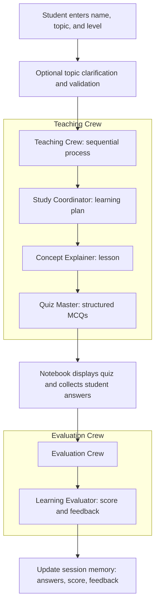

# Leo: Multi-Agent AI Tutor

**Ostad Module 27 Assignment**  
**Submitted by:** Shah Aymaan Ibtihal  
**Framework:** CrewAI 1.15.44  
**LLM:** Google Gemini (`gemini/gemini-3.5-flash`)  
**Interface:** Interactive notebook CLI (Google Colab)

## Project overview

Leo is a multi-agent AI tutoring workflow that plans a lesson, explains a student-selected topic, generates a structured multiple-choice quiz, collects the student's answers, and evaluates their learning. It uses four specialized CrewAI agents and a two-stage execution design so that a student can answer questions between teaching and evaluation.

## Agents and responsibilities

| Agent | Responsibility | Output |
| --- | --- | --- |
| **Study Coordinator** | Reviews the student's topic and learning level, identifies three objectives, and organizes the teaching plan. | Learning plan |
| **Concept Explainer** | Teaches according to the Coordinator's plan, with step-by-step explanations and practical examples. | Lesson |
| **Quiz Master** | Creates exactly three multiple-choice questions, each with four options, a correct-option number, and an explanation. | Structured quiz (Pydantic schema) |
| **Learning Evaluator** | Compares the student's answers with the quiz key, scores the answers, explains mistakes, and recommends topics to review. | Feedback report |

The agents have distinct roles, goals, backstories, and task instructions. The teaching stage is **sequential**, with explicit task context passed from the Coordinator to the Explainer and from the Explainer to the Quiz Master. The Evaluator runs in a separate CrewAI crew after the student submits answers; the quiz and answers are explicitly passed into its task. This is a predefined sequential workflow, not dynamic agent selection by the Coordinator.

## Architecture and workflow



**Human interaction:** The student selects or refines the topic and answers the quiz through the notebook's `input()` prompts. Verbose CrewAI logs display which agents and tasks are active.

## Repository files

```text
Leo_Multi_Agent_AI_Tutor/
├── Leo_Multi_Agent_AI_Tutor_Module27_Shah_Aymaan_Ibtihal.ipynb
├── README.md
└── requirements.txt
```

## Requirements and setup

- A Google Colab notebook runtime with internet access.
- A valid Google Gemini API key.
- Python packages listed in [`requirements.txt`](requirements.txt).

### Run in Google Colab

1. Open `Leo_Multi_Agent_AI_Tutor_Module27_Shah_Aymaan_Ibtihal.ipynb` in [Google Colab](https://colab.research.google.com/).
2. Run the installation/import cell, which installs `crewai[google-genai]==1.15.44`. If the runtime is restarted, run the setup cells again in order.
3. At the API-key prompt, enter your Gemini API key using `getpass()`. The notebook sets `GEMINI_API_KEY` in the current runtime; **do not paste a key directly into source code or commit one to GitHub**.
4. Run the agent/task and teaching-crew definition cells in order.
5. Enter the student's name, topic, optional more specific topic, and learning level (`beginner`, `intermediate`, or `advanced`).
6. Run the teaching stage. Follow the Coordinator, Explainer, and Quiz Master activity in the output.
7. Run the quiz-input stage and enter an option number (`1`–`4`) for each question.
8. Run the evaluation stage to see the score, incorrect-answer explanations, and recommendations.
9. Run the final memory-update cell to save the answers, score, and feedback within the session.

All cells should be run **in order** from a fresh runtime. The notebook uses `await ...kickoff_async()` because its asynchronous CrewAI calls run within the notebook environment.

## Example session

An executed sample in the notebook uses:

- **Student:** fahmid
- **Original topic:** algebra
- **Refined topic:** basics of algebra
- **Level:** beginner
- **Student answers:** `[3, 2, 4]`
- **Result:** **2/3**. The Evaluator explains that the correct solution to `2x - 3 = 7` is `x = 5` rather than `x = 10`.

This demonstrates both correct-answer scoring and constructive feedback for an incorrect answer. Responses and quiz content may vary between executions because they are generated by the model.

## Error handling and memory

- Empty names and topics trigger prompts for valid input; invalid learning levels and quiz options are requested again.
- Students may clarify a broad topic before the lesson begins.
- Teaching and evaluation execution are wrapped in `try`/`except` and `asyncio.wait_for(..., timeout=300)` for a five-minute timeout.
- If a valid structured quiz is unavailable, the quiz and evaluation stages display an explanatory message rather than proceeding normally.
- A Python `student_memory` dictionary stores the student's name, selected topic, level, quiz answers, score, and evaluation feedback **within the current runtime**.

## Limitations

- Session memory does **not** persist after a Colab runtime restart.
- The Coordinator produces a plan, while CrewAI executes the predefined sequence; the Coordinator does not dynamically reassign agents.
- The program uses notebook CLI prompts, not a standalone web interface.
- Verbose activity logs can expose the Quiz Master's answer key before the student answers; the student-facing quiz prompt itself does not print the key.
- API access, quota, and model availability depend on Google Gemini. Timeout and failure handling provide messages but do not guarantee recovery from provider outages.

## Assignment demonstration

The submission also requires a **3–5-minute demo video** showing the student input, Coordinator-to-Explainer-to-Quiz-Master handoffs, the student answering the generated quiz, the Evaluator's feedback, and the updated student memory. The video is a separate submission deliverable and is not included in these repository documentation files.
